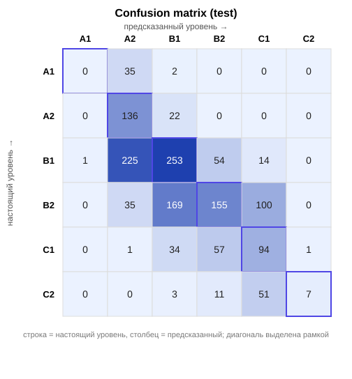

# Определение уровня английского (CEFR) по тексту — отчёт об обучении

## Данные

Источник: корпус **CEFR-SP** (Arase, Uchida, Kajiwara, EMNLP 2022) — 17 тыс. англ. предложений, размеченных двумя экспертами-филологами уровнями CEFR (A1-C2). Лицензия: часть Wiki-Auto — CC BY-SA 3.0, часть SCoRE — CC BY-NC-SA 4.0 (только некоммерческое использование). Подробности и обоснование выбора — в ml/README.md.

Согласие двух экспертов-аннотаторов:

```
Всего предложений: 10004
Эксперты совпали полностью (|annotator1 - annotator2| = 0): 4145 (41.4%)
Разошлись РОВНО на 1 уровень (|annotator1 - annotator2| = 1): 5859 (58.6%)
Разошлись на 2+ уровня (|annotator1 - annotator2| >= 2): 0 (0.0%)
Итого НЕСОВПАДЕНИЙ любых (совпали НЕ полностью): 5859 (58.6%) — совпадает с «разошлись на 1 уровень», т.к. случаев расхождения на 2+ уровня в данных нет
```

**Откуда эта цифра и как посчитана**: НЕ из статьи Arase et al. — мы не брали её оттуда и не проверяли, публикуют ли авторы такое же число. Это самостоятельный подсчёт по фактически скачанным данным: колонки `annotator1`/`annotator2` в `ml/data_raw/{train,validation,test}.csv` (это поля `Annotator I`/`Annotator II` зеркала корпуса на Hugging Face, huggingface.co/datasets/edesaras/CEFR-Sentence-Level-Annotations) — по всем 10 004 предложениям (train+validation+test вместе), формула `|annotator1 - annotator2|`, код — блок подсчёта согласия в `ml/src/prepare_dataset.py` (там же — assert, что три бакета совпадение/1 уровень/2+ уровня точно покрывают все строки без пропусков). Полностью воспроизводимо: `python ml/src/prepare_dataset.py` пересчитает то же самое заново.

**58.6% — это доля НЕСОВПАДЕНИЙ, не совпадений**: доля предложений, где два эксперта поставили РАЗНЫЕ уровни (расхождение ровно на 1 уровень CEFR). В данных не оказалось ни одного случая расхождения на 2 и более уровня, поэтому «разошлись на 1 уровень» и «разошлись хоть как-то» здесь совпадают численно — это не два разных числа, случайно оказавшихся одинаковыми, а одно и то же множество строк, потому что бакет «2+» пуст. Полное совпадение экспертов — 41.4% (другое число, ему не противоречит).

Распределение примеров по уровням и сплитам:

| split | A1 | A2 | B1 | B2 | C1 | C2 |
| --- | --- | --- | --- | --- | --- | --- |
| train | 47 | 959 | 2245 | 2472 | 1364 | 91 |
| validation | 40 | 154 | 513 | 399 | 193 | 67 |
| test | 37 | 158 | 547 | 459 | 187 | 72 |

## Какие модели пробовали

Baseline: TF-IDF (word 1-2gram) + логистическая регрессия. Сравнили 4 конфигурации на validation — раздельно балансировку классов (`class_weight`) и признаки сложности текста (средняя длина предложения/слова, лексическое разнообразие, доля длинных слов — см. ml/src/features.py), чтобы влияние каждого фактора было видно отдельно, а не смешивалось в одном сравнении:

| config | accuracy | macro_f1 | adjacent_accuracy | quadratic_weighted_kappa | recall_A1 | recall_C2 |
| --- | --- | --- | --- | --- | --- | --- |
| A_tfidf_unbalanced | 0.44 | 0.287 | 0.914 | 0.583 | 0.05 | 0.0 |
| B_tfidf_balanced | 0.373 | 0.309 | 0.899 | 0.626 | 0.125 | 0.06 |
| C_complexity_balanced | 0.451 | 0.377 | 0.937 | 0.713 | 0.15 | 0.104 |
| D_complexity_unbalanced | 0.531 | 0.371 | 0.957 | 0.722 | 0.075 | 0.0 |

- **A vs B** — балансировка классов без признаков сложности: balanced проигрывает по accuracy, но выигрывает по macro F1, QWK и recall на A1/C2 — ожидаемо, class_weight='balanced' штрафует за ошибки на редких классах сильнее, а accuracy такую разницу не видит.
- **C vs D** — то же самое, но с признаками сложности (чище, чем A vs B: отличается только class_weight, не два параметра сразу). D (без баланса) даёт заметно лучшую accuracy и adjacent accuracy, но **recall на C2 = 0** — модель вообще не находит верхний уровень target. C (с балансом) жертвует немного accuracy ради того, чтобы C2 и A1 не игнорировались полностью.
- **B vs C** — добавление признаков сложности поверх TF-IDF заметно поднимает все метрики, гипотеза задания подтвердилась.

**Выбрана конфигурация: `C_complexity_balanced`** (macro F1 на validation = 0.377).

Отбор — по правилу «лучший macro F1, но при разнице меньше 0.01 предпочесть вариант с recall(A1) > 0» (см. `pick_best()` в `ml/src/train_baseline.py`); в данном прогоне tie-break не понадобился — C выиграл по macro F1 напрямую (и у C recall(A1) и так выше, чем у D).


### Почему не дообучали DistilBERT
Пробовали оценить: дообучение DistilBERT требует `torch` + `transformers` + веса модели — суммарно несколько сотен МБ. Замер реальной скорости сети в этом окружении (curl к PyPI, GitHub, huggingface.co) дал ~25 КБ/с устойчиво на всех трёх хостах — то есть только загрузка библиотек заняла бы часы, а дообучение на CPU без GPU для этой задачи не оправдано при таком размере датасета (10 тыс. коротких предложений). Baseline на TF-IDF в такой ситуации — осознанный выбор, а не компромисс от лени: он обучается за секунды и даёт интерпретируемые веса (видно, какие слова/n-граммы толкают предсказание к тому или иному уровню), что тоже плюс для защиты перед жюри.

## Масштабирование признаков: два раунда экспериментов

**Раунд 1 (исправление ConvergenceWarning).** На `max_iter=2000` `LogisticRegression` не успевала сойтись. Проверили два способа:

| вариант | ConvergenceWarning | accuracy (val) | macro F1 (val) |
| --- | --- | --- | --- |
| до исправления (max_iter=2000) | да | 0.455 | 0.379 |
| max_iter=5000, без скейлера | нет | 0.452 | 0.377 |
| max_iter=5000 + StandardScaler(with_mean=False) НА ВСЮ матрицу | нет | 0.389 | 0.284 |

Масштабирование ВСЕЙ матрицы (TF-IDF + признаки сложности одним скейлером) устраняло предупреждение, но заметно портило качество: на разреженной TF-IDF-матрице большинство признаков (редкие n-граммы) имеют маленький std, а значит получают большой множитель `1/std` — масштабирование раздувает вес шума, а не сигнала. Оставили просто `max_iter=5000` — предупреждение пропадает без этой побочки (сходится за ~2730 итераций вместо обрыва на 2000).


**Раунд 2 (эта итерация): масштабирование ТОЛЬКО признаков сложности.** Раунд 1 уже убрал ConvergenceWarning — раунд 2 не чинит его заново, а уточняет архитектуру: признаки сложности (`ComplexityFeaturizer`) — это 6 плотных чисел с сильно разным масштабом (`word_count` — десятки-сотни, `lexical_diversity` — 0-1), и без масштабирования на фоне TF-IDF (у него все значения и так в сравнимом диапазоне за счёт `sublinear_tf`) они либо теряются, либо доминируют непропорционально. `StandardScaler()` теперь стоит ТОЛЬКО внутри ветки `complexity` в `FeatureUnion` — TF-IDF её не видит вообще, поэтому проблема раунда 1 (раздувание шума редких n-грамм) здесь неприменима: масштабируем не то, что её вызывало.

Эффект на конфигурацию C (`C_complexity_balanced`, макро F1 на validation, оба варианта уже с max_iter=5000): было 0.377 (без масштабирования complexity) → стало 0.377 (с масштабированием). Разница в пределах шума обучения — цель раунда 2 была не «поднять метрику любой ценой», а сделать признаки сложности сравнимыми по масштабу с TF-IDF корректно, не трогая то, что уже работало; заодно раунд 2 добавил четвёртую конфигурацию (D — признаки сложности без балансировки классов), которой в раунде 1 не было, и сейчас именно она — ближайший конкурент C (см. таблицу выше).

## Метрики на test (финальные, не участвовавшие в отборе модели)

Сравнение с majority baseline (правило «всегда предсказывать самый частый уровень в train» — это `B2`), а не со случайным угадыванием 1/6: baseline тоже кое-что «знает» о перекосе классов (см. распределение выше), поэтому именно он — честная точка отсчёта, ниже которой модель бесполезна.

**Adjacent accuracy у самого baseline уже 0.817** — это не ошибка и не подгонка: раз почти все уровни в датасете и так соседние с самым частым (B2), правило «всегда B2» почти всегда промахивается не больше чем на один уровень просто по своей природе. Поэтому adjacent accuracy сама по себе — плохой критерий качества модели здесь (высокий даже у бессмысленного правила); **главная ordinal-метрика — quadratic weighted kappa (QWK)**, она как раз вычитает то, что можно получить и без обучения (у majority baseline QWK = 0 по определению).

| модель | Accuracy | Macro F1 | Adjacent accuracy | QWK |
| --- | --- | --- | --- | --- |
| Majority baseline (всегда B2) | 0.314 | 0.08 | 0.817 | 0.0 |
| Наша модель (C_complexity_balanced) | 0.442 | 0.328 | 0.931 | 0.68 |

**Ещё одна точка отсчёта — сами эксперты.** Они согласны друг с другом в 41.4% случаев (расходятся в 58.6%, см. раздел «Данные» выше); accuracy модели на test — 44.2%, то есть в том же диапазоне, что и согласие экспертов. Оговорка обязательна: эталонная метка для обучения и проверки сама получена из мнений тех же двух аннотаторов (см. `resolve_gold_label()`), поэтому это не «модель обгоняет экспертов» — оба числа считаются на данных с одним и тем же источником шума, сравнение приблизительное и годится только как ещё одна иллюстрация того, что задача сама по себе трудна даже для людей, а не как строгое доказательство качества модели.

**Adjacent accuracy** — доля предсказаний, где модель ошиблась не больше чем на один уровень CEFR (например, назвала B2 вместо B1). **Quadratic weighted kappa (QWK)** — согласие с разметкой за вычетом случайного совпадения, с квадратичным штрафом за далёкие ошибки (0 — как случайное угадывание с тем же распределением классов, что и в данных; 1 — идеальное совпадение).

**Разрыв validation → test по macro F1: 0.377 → 0.328** (падение на 0.048). Конфигурация выбиралась по validation, а не по test — небольшое падение на test ожидаемо и нормально (это и есть весь смысл раздельных validation/test: увидеть честную, не подогнанную под отбор оценку); тревожным был бы разрыв на порядок больше этого.

Подробно по каждому уровню (precision/recall/F1):

```
              precision    recall  f1-score   support

          A1      0.000     0.000     0.000        37
          A2      0.315     0.861     0.461       158
          B1      0.524     0.463     0.491       547
          B2      0.560     0.338     0.421       459
          C1      0.363     0.503     0.422       187
          C2      0.875     0.097     0.175        72

    accuracy                          0.442      1460
   macro avg      0.439     0.377     0.328      1460
weighted avg      0.496     0.442     0.429      1460

```

## Confusion matrix



Ошибки в основном ожидаемо сосредоточены рядом с диагональю — модель путает соседние уровни (например, B1 и B2) чаще, чем далёкие (A1 и C2), что соответствует самой природе шкалы CEFR: границы между соседними уровнями размыты даже для людей-экспертов (см. согласие аннотаторов выше и adjacent accuracy).

## Дополнительный эксперимент: перекос классов между официальными сплитами

Диагностика recall(A1)=0 на test выявила побочный вопрос: доли уровней в train/validation/test официального разбиения сильно расходятся — например, A1 занимает 0.65% train, но 2.93%/2.53% validation/test (в 4+ раза больше), C2 — 1.27% train против 4.90%/4.93% (тоже почти в 4 раза). Разобрались, откуда это и что меняется, если поправить.

**Откуда взялось официальное разбиение.** `ml/src/prepare_dataset.py` train/validation/test **не считает** — он только читает три уже готовых файла:

```python
def load_split(name: str) -> pd.DataFrame:
    df = pd.read_csv(RAW_DIR / f"{name}.csv")
    ...

splits = {name: load_split(name) for name in ["train", "validation", "test"]}
```

Сам файл `ml/data_raw/{train,validation,test}.csv` — это готовые сплиты, скачанные `fetch_dataset.py` из зеркала CEFR-SP на Hugging Face; оригинальный репозиторий корпуса (`yukiar/CEFR-SP`) прямо говорит, что разбиение сделано **по источнику предложений** (Wiki-Auto / SCoRE / Newsela-Auto), а не случайным перемешиванием — см. `ml/README.md`, раздел «Как выбирали лучшую конфигурацию». Это **официальный сплит датасета**, не наше решение.

**Почему доли классов различаются.** Колонки с названием источника (Wiki-Auto/SCoRE/Newsela-Auto) в скачанных данных нет вообще — проверено напрямую через API датасета (`features = [text, Annotator I, Annotator II]`, больше ничего), поэтому напрямую показать «распределение уровней по источникам» нельзя. Но раз разбиение сделано по источнику, а не по метке, и разные источники — это разные виды текстов (упрощённые статьи Wiki-Auto vs. задания экзамена SCoRE), у них естественно разный состав уровней CEFR — отсюда и разный состав уровней в train/validation/test, полученных из разных долей этих источников.

**Стратифицированное разбиение (эксперимент, НЕ замена официального и НЕ «более честная» версия).** Все 10 004 предложения (train+validation+test вместе) переразбиты 70/15/15 через `sklearn.model_selection.train_test_split(..., stratify=level_code, random_state=42)` — сохранено отдельно в `ml/data/stratified_{train,validation,test}.csv`, официальные `ml/data/{train,validation,test}.csv` не тронуты. На новом train/validation/test обучены и сравнены те же C и D, тем же `pick_best()`; дополнительно — stratified 5-fold CV по всем 10 004 строкам для C_complexity_balanced (`ml/src/stratified_experiment.py`).

Важно точно понимать, что именно измеряет каждый из двух сплитов — это **не** «плохой» и «хороший» вариант одного и того же, а два разных вопроса:
- **официальное разбиение** (по источнику) — оценивает **обобщение на новый источник текста**, которого модель на train не видела вообще (ближе к тому, как реально будут выглядеть тексты учеников на сайте — не парафраз чего-то из train);
- **стратифицированное разбиение** (по метке) — оценивает **качество внутри уже знакомого распределения** источников/формулировок, а не обобщение на новое. Как показал отдельный разбор утечки ниже, у этого разбиения есть побочный эффект: из-за выровненных парафразов Wiki-Auto/Newsela часть test-предложений оказалась почти дубликатами train-предложений.

| Способ | Accuracy | Macro F1 | Adjacent acc. | QWK | F1(A1) | F1(C2) |
| --- | --- | --- | --- | --- | --- | --- |
| Официальное разбиение (test) | 0.442 | 0.328 | 0.931 | 0.680 | 0.000 | 0.175 |
| Стратифицированное (test, целиком) | 0.501 | 0.423 | 0.932 | 0.693 | 0.200 | 0.286 |
| Stratified 5-fold CV (среднее ± std) | — | 0.469 ± 0.006 | — | 0.710 ± 0.006 | 0.369 ± 0.115 | 0.371 ± 0.082 |

На стратифицированном test строка A1 confusion matrix: `[4, 13, 1, 0, 0, 0]` (4 из 18 A1-предложений угаданы верно, 13 спутаны с A2, 1 с B1) — на официальном test было 0 из 37.

### Проверка на утечку данных (почти-дубликаты train/test)

CEFR-SP частично состоит из Wiki-Auto и Newsela-Auto — это корпуса **выровненных упрощений**: одно и то же предложение (или очень близкий его пересказ) встречается в исходном и в упрощённом виде как отдельная строка. При случайном (в т.ч. стратифицированном) перемешивании такие пары могут разъехаться по train и test. Проверили отдельным TF-IDF-векторизатором (word 1-2gram, не тот объект, что в модели): для каждого test-предложения — максимальное косинусное сходство с любым train-предложением (`ml/src/leakage_check.py`).

| Разбиение | >0.9 | >0.8 | >0.7 | медиана | максимум |
| --- | --- | --- | --- | --- | --- |
| Стратифицированное | 44 (2.9%) | 138 (9.2%) | 232 (15.5%) | 0.262 | 1.000 |
| Официальное | 0 (0.0%) | 0 (0.0%) | 1 (0.1%) | 0.157 | 0.726 |

**Подтверждено: у стратифицированного разбиения реальная утечка почти-дубликатов, у официального — практически нет.** Топ-совпадения на стратифицированном test — это буквально те же предложения с точностью до пунктуации/артикля (sim=1.000), например: test `"On - shore and off-shore winds can be extremely strong as the lake warms..."` — train `"On - shore and off-shore winds can be extremely strong , as the lake warms..."`. На официальном разбиении максимум сходства среди ВСЕХ пар test×train — всего 0.726, и это уже совсем разные по формулировке предложения.

Переобучили модель на stratified train и посчитали метрики на test **целиком** и **только на предложениях со сходством < 0.7** (то есть без вероятных дубликатов):

| Подмножество stratified test | n | Accuracy | Macro F1 | QWK | F1(A1) | F1(C2) |
| --- | --- | --- | --- | --- | --- | --- |
| Целиком (а) | 1501 | 0.501 | 0.423 | 0.693 | 0.200 (n=18) | 0.286 (n=35) |
| Сходство < 0.7 (б) | 1269 | 0.495 | 0.396 | 0.692 | 0.114 (n=16) | 0.222 (n=27) |
| Сходство ≥ 0.7 (для контроля) | 232 | 0.534 | 0.549 | 0.626 | 0.800 (n=2) | 0.476 (n=8) |

**Метрики на стратифицированном разбиении могут быть завышены за счёт утечки почти-дубликатов.** Разложение этого эффекта отдельно по F1(A1) (n=16 в подвыборке «сходство < 0.7») и F1(C2) (n=27) статистически ненадёжно — выборки слишком малы, чтобы делать выводы о конкретной доле вклада утечки в каждый класс. Надёжный вывод есть только для macro F1 (там выборка — весь test, 1501/1269 предложений): **≈0.33 на официальном разбиении** (оценка обобщения на новый источник), **≈0.40 на стратифицированном без почти-дубликатов** (сходство < 0.7) — то есть утечка добавляла сверху ещё **≈0.03**.

**Официальное разбиение остаётся основным результатом проекта** (раздел «Метрики на test» выше) — оно оценивает обобщение на новый источник текста и сравнимо с методологией статьи CEFR-SP (train/test изначально разделены по источнику, поэтому почти-дубликатов между ними практически нет — подтверждено выше цифрами, а не только доверием к авторам корпуса), и на нём отобрана и сохранена модель `ml/models/cefr_model.joblib`. Стратифицированное разбиение и CV — дополнительный диагностический эксперимент про качество внутри известного распределения, его результаты нигде не заменяют официальные и не пересохранены как основная модель; интерпретировать их в отрыве от таблицы утечки выше не стоит.
